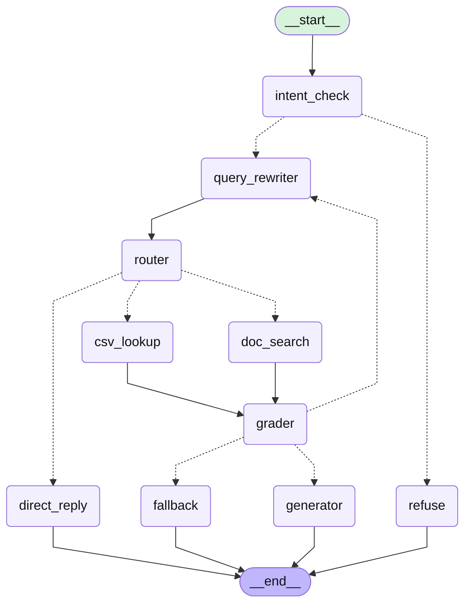

# India Union Budget 2024-25 LangGraph Chatbot

A multi-turn agentic RAG chatbot built with **LangGraph**, **FAISS**, **Pandas**, and **Streamlit** that answers questions strictly from the official India Union Budget 2024-25 documents (presented on 23 July 2024).

## Architecture



### Key Design Choices
- **Re-runnable Ingestion (`ingest.py`):** Loads 4 PDFs (`pypdf`) and 1 `.docx` (`python-docx`), preserves file name and page/paragraph metadata, chunks with `RecursiveCharacterTextSplitter`, and rebuilds `faiss_index/` cleanly on every run.
- **Safe Table Engine (`csv_tool.py`):** Uses a Pydantic structured output schema (`CSVQueryPlan`) so the LLM only selects whitelisted operations (`lookup`, `sum`, `compare`, `percentage_change`, `top_n`) and column names. Deterministic Pandas code executes all calculations with zero `exec()`/`eval()`.
- **Bounded Retry Loop (`graph.py`):** If `grader` rejects the retrieved context, the graph rewrites the query and retries once (`retries <= 1`). A second rejection routes to `fallback` (`"I don't have enough reliable information"`).
- **Conversation Memory:** Uses LangGraph's `MemorySaver` checkpointer with per-session `thread_id`s.

## Setup & Usage

1. **Create a virtual environment and install dependencies:**
   ```bash
   python -m venv venv
   venv\Scripts\activate
   pip install -r requirements.txt
   ```
2. **Configure environment variables:**
   Copy `.env.example` to `.env` and add your Gemini API key:
   ```text
   GOOGLE_API_KEY=your_gemini_api_key_here
   GEMINI_MODEL=gemini-3.5-flash-lite
   ```
3. **Download documents & extract `budget_table.csv` (50 rows):**
   ```bash
   python download_data.py
   python extract_table.py
   ```
4. **Build the FAISS vector index (re-runnable):**
   ```bash
   python ingest.py
   ```
5. **Run the Streamlit Chat UI:**
   ```bash
   python -m streamlit run app.py
   ```
6. **Run the 20-question evaluation:**
   ```bash
   python evaluate.py --questions questions.json
   ```

## Evaluation Results

Evaluated across 20 questions (8 document factual, 5 table lookup/calculation, 3 multi-turn follow-ups, 2 unanswerable, 2 off-topic/injection). At least 5 answers were hand-verified against `eval_results.json`.

| Metric | Score | Details |
| :--- | :---: | :--- |
| **Answer Accuracy** | **90.0%** | 18 / 20 correct |
| **Citation Correctness** | **95.0%** | 19 / 20 correct |
| **Routing Correctness** | **85.0%** | 17 / 20 correct |
| **Average Latency** | **19.56s** | Across 20 queries (including retry loops) |

## Next Steps
- **Reduce latency:** Merge `intent_check` and `router` into a single structured LLM call to cut 1–2 round-trips per turn.
- **Cross-fallback on retry:** When `csv_lookup` returns empty or fails grading, force the retry to route to `doc_search` instead of re-querying the same CSV.
- **Persistent checkpointer:** Swap `MemorySaver` for `SqliteSaver` so conversation threads survive app restarts.
